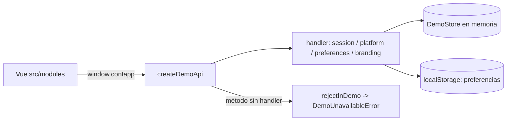

# DEMO-API — la API simulada de Fiscenix Web

## Qué es y por qué existe

`src/demo` implementa `DesktopApi` (`shared/contracts/desktop.ts`) en el navegador. La UI de Fiscenix sólo habla con `window.contapp`; `main.ts` instala `window.contapp = createDemoApi(...)` antes de montar la app, así los módulos Vue se reutilizan casi intactos sin Electron ni Host.

## Flujo de una llamada

`createDemoApi` reparte el contrato: los handlers simulados y, para el resto, `rejectInDemo`. El literal está tipado `DesktopApi`, así que añadir un método al contrato rompe el typecheck hasta listarlo.

## Cobertura en la entrega 0

| Handler | Cubre |
| --- | --- |
| `demoSessionHandler` | Inicio/cierre de sesión con los perfiles demo (`demo1234`), sesión actual y `readWorkspaceAccess` |
| `demoPlatformHandler` | Plataforma y recarga de página simuladas |
| `demoPreferencesHandler` | Lectura y actualización de preferencias locales |
| `demoBrandingHandler` | Marca del despacho desde el store |

Todo lo demás (clientes, documentos, movimientos, tareas, SAT, correo, respaldos, notas, XML, impresión...) está rechazado. Cada perfil tiene `noWorkspaceAccess`: ningún módulo es accesible, y la entrada "Catálogos SAT" está oculta hasta su entrega.

## Datos

- **EPHEMERAL** (`DemoStore`, memoria): usuarios y marca, sembrados por `createDemoSeed`; se pierden al recargar.
- **LOCAL** (`localStorage`, clave `fiscenixWeb.localPreferences`): preferencias del dispositivo como el tema; sobreviven a la recarga.

## Contrato `DemoUnavailableError`

`rejectInDemo(methodName)` devuelve una función que rechaza siempre con `DemoUnavailableError` (`"<método> no está disponible en la demo web."`). La UI debe tratarlo como error legible, nunca como fallo silencioso.

## Añadir un módulo en una entrega posterior

1. Escribir su handler en `src/demo/handlers/` sobre `DemoStore`.
2. Esparcirlo en `createDemoApi` y quitar sus claves de la lista de `rejectInDemo`.
3. Activar sus flags de `WorkspaceAccess` por perfil en `demoProfiles.ts`.
4. Extender el seed en `demoSeed.ts`.
5. Pruebas unitarias del handler y e2e; actualizar este documento.
