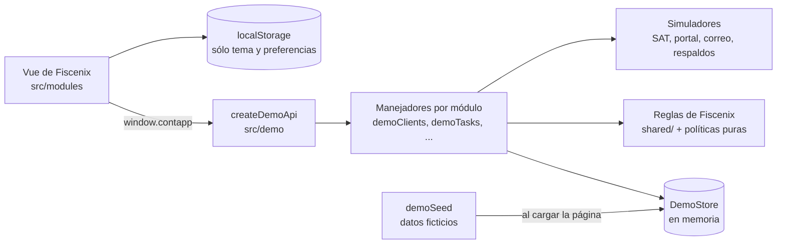

# Fiscenix Web (demo) — diseño

## Intención y por qué

El legacy web se convierte en **Fiscenix Web**, una demo pública para el **portafolio** del autor. Es la misma app que Fiscenix escritorio (`ContaApp2`), con el mismo diseño y las mismas funciones, pero corre **entera en el navegador** y se publica en **Vercel**.

Quien la visite entra sin cuenta y recorre un despacho contable ficticio: clientes, tareas, cobros, reportes fiscales, opiniones, conciliación, notas y SAT. Todo lo que en Fiscenix habla con el SAT, envía correo o hace respaldos **simula** que lo hace. No hay servidor: los datos de cada visitante viven en la memoria de su pestaña y **se borran al recargar o al salir**.

Éxito significa que:

- abrir la URL y pulsar "Entrar a la demo" lleva a una app que se ve y se comporta como Fiscenix;
- cada visitante tiene su propia copia de los datos y nadie puede romper la demo de otro;
- el código se puede mostrar: TypeScript estricto, responsabilidades claras, pruebas y documentación.

## Metas

1. Las pantallas, flujos y reglas de Fiscenix funcionan en el navegador, salvo lo exclusivo de escritorio ("Fuera de alcance").
2. La app no necesita servidor, base de datos, Fiscenix escritorio ni Electron: es un sitio estático.
3. Cada carga parte de los mismos datos de ejemplo. Recargar o cerrar borra lo que hizo el visitante.
4. SAT, portal, consulta de opiniones y CSF, correo y respaldos se simulan de forma creíble: progreso, tiempos, éxitos y algunos fallos de ejemplo.
5. Se despliega en Vercel desde el repo, sin configuración manual.

## No metas

- Backend real, base de datos, autenticación real o modo "producción".
- Importar datos del legacy o sincronizar con Fiscenix escritorio.
- Seguir igualando a Fiscenix después del port: cada repo evoluciona por su lado.
- Guardar el trabajo del visitante entre recargas.

## Anti-metas (fallaría aunque "funcione")

- Que la demo haga cualquier petición real al SAT, a un SMTP o a otro servicio externo.
- Que se vea o se comporte distinto de Fiscenix en lo portado: otro diseño, pasos de captura saltados, reglas de validación o permisos distintas.
- Que los datos de un visitante sobrevivan a una recarga o lleguen a otro visitante.
- Que parezca un mock pobre: listas vacías, botones que no hacen nada, errores sin mensaje.

## Restricciones

- Las reglas de `ContaApp2/AGENTS.md` aplican al código: inglés en nombres técnicos, `camelCase`, TypeScript `strict` sin `any`, una responsabilidad por archivo, comentarios de flujo y documentación con Mermaid.
- El sistema visual es el de `ContaApp2/DESIGN.md`: brutalista, Light/Dark, Geist empaquetada.
- Sitio estático: nada de procesos, disco, impresoras, Playwright ni funciones de servidor.
- CSP con `connect-src 'self'`, para que el navegador mismo impida llamadas externas por error.

## Enfoques considerados

| Enfoque | Trade-off | Decisión |
|---|---|---|
| A. Edición web dentro de ContaApp2 | Un solo código, pero no es un proyecto aparte | Descartado: el autor la quiere aparte para el portafolio |
| B1. Rehacer el legacy pantalla por pantalla | Conserva el código legacy; lento y fácil de desalinear | Descartado |
| **B2. Llevar el código de Fiscenix al repo del legacy** | Igual desde el inicio, TS estricto y pruebas existentes | **Elegido** |
| B2 con backend real (Express + MySQL) | Muestra backend, pero duplica el trabajo y Vercel no lo aloja; nadie lo vería en la URL pública | Descartado: **sólo demo** |

Consecuencias:

- `despachoapp-server` y `despachoapp-docker-compose` dejan de usarse. No se borran; su README dirá que fueron reemplazados.
- El contenido actual de `despachoapp-vue/src` se reemplaza, incluido el restyle del 2026-11-18 (staged, sin commit).

## Arquitectura

### Cómo encaja con Fiscenix

- La UI de Fiscenix sólo habla con `window.contapp: DesktopApi` (`ContaApp2/shared/contracts/desktop.ts`). Eso es lo que hace posible el port.
- `src/` y `shared/` se copian de ContaApp2 en el commit `c0c00bf`. Los módulos Vue se tocan lo menos posible.
- `main.ts` instala `window.contapp = createDemoApi()` antes de montar la app.
- `createDemoApi` devuelve el `DesktopApi` completo (porque `window.contapp` está tipado `DesktopApi` y las pantallas copiadas compilan contra él); los métodos no simulados rechazan con `DemoUnavailableError`, y la UI exclusiva de escritorio se quita de las pantallas en lugar de simularse.

### `src/demo/`: la API simulada

| Pieza | Qué hace |
|---|---|
| `DemoStore` | Las colecciones en memoria (clientes, perfiles, usuarios, roles, tareas, movimientos, reportes, opiniones, obligaciones, conciliaciones, notas, biblioteca XML, correo, marca, respaldos). Se crea al cargar la página y nunca se persiste. |
| `demoSeed` | Datos ficticios coherentes, con fechas relativas a "hoy". Detalle en "Datos de ejemplo". |
| Un manejador por módulo (`demoClients`, `demoTasks`, `demoMovements`, …) | Implementa los métodos `manage*` y `read*` de ese módulo sobre el store y devuelve exactamente la forma de `shared/contracts/*`. |
| Reglas | Usa la lógica pura de `shared/` (RFC, DIOT, conciliación, obligaciones, QR de CSF, `parseCfdi`, `analyzeCfdi`) y las políticas puras de `server/modules` (por ejemplo `TaskPolicy`) copiadas a `src/demo/rules`, para que las validaciones y mensajes sean los de Fiscenix. |
| Simuladores | SAT WS, portal SAT (con captcha de ejemplo), consulta pública de opiniones y CSF, envío de correo y respaldos. Usan temporizadores y progreso, y devuelven resultados de ejemplo con alguna falla controlada para mostrar los estados de error. Nunca hacen `fetch` externo. |
| Eventos | Las invalidaciones en vivo de Fiscenix (`manageHostEvents`) se emiten localmente cuando un manejador cambia el store, para que las listas se refresquen igual que en escritorio. |

### Sesión y permisos

- El acceso de Fiscenix se conserva. Con un aviso de demo debajo, ofrece **"Entrar a la demo"** con un selector de perfil: Administrador, Contador o Auxiliar. Cada perfil es un usuario sembrado con su rol. Entrar con otro perfil muestra cómo cambian menús y acciones según los permisos.
- Los permisos y asignaciones se evalúan en el manejador con las mismas reglas de Fiscenix, aunque todo sea local, para que la demo enseñe el comportamiento real.
- Las operaciones sensibles piden la reconfirmación de Fiscenix. La contraseña de todos los perfiles demo es `demo1234` y aparece en el aviso.
- Cerrar sesión vuelve al acceso sin borrar los datos de la pestaña. Recargar sí los borra.

### Equivalentes de navegador

| En escritorio | En la demo |
|---|---|
| Notas locales (archivo cifrado) | En el store. Exportar descarga un archivo; importar lee uno con `<input type=file>` |
| Biblioteca XML local | En el store. Importar XML o ZIP se lee en el navegador y se analiza con `parseCfdi`/`analyzeCfdi` |
| PDF con `printToPDF` (reportes, tareas, obligaciones, CFDI) | El mismo HTML de Fiscenix (`fiscalPdfHtml`, `taskReportHtml`, `obligationReportHtml`) se muestra en una vista previa, y "Guardar PDF" o "Imprimir" usa el diálogo del navegador |
| XLSX, CSV y TXT de la DIOT | Se generan en el navegador (`exceljs`, como hace Fiscenix) y se descargan |
| Estados de cuenta PDF, CSV o XML | Se leen en el navegador (`readPdfText` con pdf.js, que ya está en `shared/`) |
| Tickets en impresora térmica | `ticketLayout`/`ticketDocuments` en una vista de 58/80 mm con `window.print()` |
| Elegir archivos o carpetas, abrir PDF externo | `<input type=file>`, descargas y vistas en la app |
| QR de la CSF con cámara | `getUserMedia`, igual que Fiscenix. La consulta al SAT se simula |
| Preferencias del dispositivo | `localStorage` (tema, color de acento, fondo). Es lo único que sobrevive a la recarga |

### Datos de ejemplo (`demoSeed`)

Un despacho ficticio ("Despacho Demo") con marca y logo propios:

- 3 usuarios de demo más 4 empleados, con roles y fotos;
- unos 25 clientes con perfiles, regímenes, asignaciones y obligaciones; algunos con documentos PDF de ejemplo y CSF;
- tareas en los tres estados, con responsables y clientes;
- unos 6 meses de movimientos (ingresos, gastos y gastos del despacho), con un corte de caja hecho;
- reportes fiscales con CFDI ficticios, para que la DIOT y los totales tengan contenido;
- opiniones de cumplimiento con resultados variados;
- una conciliación de ejemplo, notas con carpetas, XML en la biblioteca, plantillas de correo y un historial de descargas SAT y de respaldos.

RFC, nombres, correos y montos son inventados: válidos en formato y sin corresponder a nadie real. Todas las fechas se calculan desde la fecha de hoy, para que "vence esta semana" siempre tenga algo.

### Publicación en Vercel

- `vite build` genera un sitio estático. `vercel.json` hace el rewrite de la SPA a `index.html` y declara las cabeceras: CSP (`default-src 'self'`; `connect-src 'self'`; imágenes `self data: blob:`; cámara permitida), `X-Content-Type-Options`, `Referrer-Policy` y `frame-ancestors 'none'`.
- Sin funciones de servidor ni variables secretas.
- Un aviso fijo y discreto: "Demo · los datos se borran al recargar · SAT y correo simulados", con enlace al repo.

## Fuera de alcance

- **Exclusivo de escritorio:** emparejamiento de dispositivos, enlace USB, descubrimiento y confianza TLS del Host, instalación, Docker y MySQL administrados, diagnósticos, selección de impresora, migración legacy y respaldos reales.
- **Lo que Fiscenix ya retiró del legacy:** Agnes Printer, pagos mensuales, passkeys, registro público y "deshacer" desde el registro.

## Entregas (orden propuesto)

Cada entrega queda publicada en Vercel y probada. El plan detallado se escribe por entrega.

0. **Base:** reemplazar `src/` con el de Fiscenix, agregar `shared/`, el esqueleto de `createDemoApi` y `DemoStore`, el acceso con "Entrar a la demo", el shell y el diseño, `vercel.json` y la prueba de humo. Se publica con Inicio y sin módulos.
1. **Clientes:** perfiles, asignaciones, documentos y CSF/QR.
2. **Acceso:** usuarios, roles, permisos, fotos y reconfirmación.
3. **Tareas:** con la vista previa del reporte.
4. **Movimientos:** pagos, gastos, corte de caja y tickets.
5. **Fiscal:** biblioteca XML, análisis CFDI, reportes, DIOT, XLSX y PDF.
6. **Cumplimiento:** opiniones y obligaciones.
7. **Conciliación bancaria.**
8. **Notas.**
9. **SAT simulado:** descargas masivas, programaciones y portal con captcha de ejemplo.
10. **Correo simulado, marca, catálogos SAT, Inicio completo, panel de equipo y respaldos simulados.**
11. **Pulido de portafolio:** sembrador completo, README con capturas y GIF, enlace público.

## Pruebas

- Las pruebas unitarias de `shared/` que vienen de ContaApp2 se conservan (Vitest).
- Cada manejador de `src/demo` tiene pruebas de sus reglas: validación, permisos y formas de respuesta contra `shared/contracts`.
- Una prueba Playwright de humo contra el build recorre: entrar a la demo, crear un cliente, recargar y comprobar que ya no está. La parte de crear un cliente llega en la entrega 1 (la entrega 0 no tiene módulos); el humo de la entrega 0 comprueba el acceso y que recargar olvida la sesión.

## Decidido por el autor

- Enfoque B2, en el repo del legacy, como proyecto aparte para el portafolio.
- Mismo diseño y mismas funciones que Fiscenix.
- Sólo demo, sin backend; publicada en Vercel.
- Todo se simula; nada se hace de verdad.
- Los datos del visitante se borran al recargar o salir de la app.
- Equivalentes de navegador para lo que en escritorio es local.

## Decisiones propuestas (llamadas de Claude, corregibles)

- Fuente congelada en ContaApp2 `legacy-migration` `c0c00bf`.
- Selector de perfil (Administrador, Contador, Auxiliar) para mostrar los permisos; contraseña `demo1234` visible para las reconfirmaciones.
- Los datos viven sólo en memoria (ni `sessionStorage` ni IndexedDB), para cumplir "se borra al recargar". Sólo las preferencias van a `localStorage`.
- PDFs como vista previa HTML más el diálogo de impresión del navegador, en vez de generar bytes PDF. Es lo más fiel al HTML de Fiscenix sin un motor de PDF.
- Los simuladores incluyen algunas fallas controladas para que se vean los estados de error y reintento.
- `despachoapp-server` y `despachoapp-docker-compose` quedan sin uso, con una nota en su README; no se borran.
- El trabajo va en una rama nueva de `despachoapp-vue` (`fiscenix-web`).

## Lo que queda al constructor

- Qué métodos de `DesktopApi` quedan en `DemoApi` y qué partes de pantalla se quitan por depender de escritorio.
- Qué políticas de `server/modules` son puras y se copian, y cuáles se reescriben en el manejador.
- La forma interna de `DemoStore` y de cada manejador.
- El contenido concreto del sembrador, respetando la lista de arriba.
- Cómo partir cada entrega en tareas y pruebas, y las versiones de dependencias (siguiendo ContaApp2).
